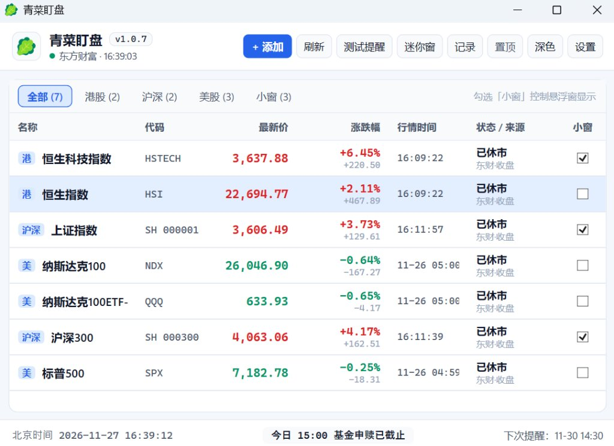
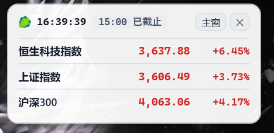

# 🥬 MarketWatch | 青菜盯盘

青菜盯盘（MarketWatch）是一款面向 Windows 10/11 的本地桌面行情监控与场外基金交易截止提醒工具，基于 .NET 10 LTS、WPF 与 ScottPlot 5 构建。

应用专注于多市场指数与自选标的的轻量实时盯盘，并围绕**北京时间 15:00 前场外基金申赎截止窗口**提供独立于系统音频与通知中心的静音强视觉置顶提醒，所有配置、历史记录与日志均保存在本机。



<p>
  
</p>

---

## 主要功能

| 模块 | 核心能力 |
| --- | --- |
| 自选盯盘与分组 | 覆盖港股、沪深与美股指数/个股/ETF，支持按「全部 / 港股 / 沪深 / 美股 / 小窗」标签分组浏览、搜索添加、排序与异步批量刷新 |
| 静音强视觉提醒 | 固定按北京时间（UTC+8）调度，默认 14:30 / 14:45（普通）与 14:55（强提醒呼吸边框）置顶弹窗，不依赖系统提示音或 Toast 通知，支持 1 分钟稍后提醒与实时截止倒计时 |
| 悬浮迷你小窗 | 独立置顶、可拖拽且透明度可调的桌面精简窗口，可在主列表勾选「小窗」按需挑选展示标的，控制小窗体积 |
| 当日真实分时图 | 单击任意标的展开当日分时曲线，保留真实时间戳、午休空档与昨收虚线基准；无数据时如实提示 |
| 价格与涨跌幅预警 | 支持按最新价或涨跌幅设置上穿/下穿阈值触发独立提醒，具备时间戳单调校验、冷却防抖与反向复位机制 |
| 交易日历管理 | 支持「仅工作日」与「基金交易日历」模式，内置 2026 年沪深、港股（含半日市）及美股（含夏令时与提前收市）官方节假日安排，并支持自定义休市日与开放日 |

- **可靠调度与边界保护**：支持单实例唤醒（杜绝双重闹钟）、休眠/锁屏延迟与解锁结算、跨时区固定北京时间触发，以及独立去重持久化，避免重复弹窗或过时下单提示。
- **全局深浅色主题与高 DPI 适配**：支持一键切换深色 / 浅色全局主题（含 Windows 10/11 原生标题栏同步适配）、红涨绿跌 / 绿涨红跌配色切换及 Per-Monitor V2 高分屏显示。
- **配置管理与系统集成**：支持系统托盘常驻、可选开机自启动（默认关闭）、历史触发记录查询、JSON 配置导出/导入及损坏自动备份恢复。
- **内置版本更新**：支持从 GitHub Releases 检查最新正式版本、流式下载校验并一键重启升级。

---

## 安装与使用

1. 前往 [GitHub Releases](https://github.com/linkyu9319/MarketWatch/releases/latest) 下载最新版本的 `MarketWatch-<version>-win-x64.exe`（Windows x64 独立单文件，无需额外安装 .NET 运行时）。
2. 双击即可运行；主窗口顶部提供标的添加、手动刷新、静音测试提醒、悬浮小窗、历史记录、窗口置顶、深浅主题与设置入口。
3. 在自选列表顶部可按「全部 / 港股 / 沪深 / 美股 / 小窗」切换分组；勾选右侧「小窗」复选框即可决定哪些标的显示在桌面悬浮迷你窗中。
4. 点击窗口关闭按钮默认最小化至系统托盘继续后台调度，如需完全退出请在托盘图标右键菜单中选择“退出程序”。

支持的命令行启动参数：
- `--minimized`：启动后直接驻留系统托盘（开机自启动默认使用此参数）。

---

## 行情数据源与延迟说明

公开行情接口的实盘对比记录与采样数据见 [docs/data-provider-validation.md](docs/data-provider-validation.md)。

| 角色 | 数据源 | 说明 |
| --- | --- | --- |
| 默认主源 | 东方财富 (`push2.eastmoney.com`) | 覆盖港/沪深/美股批量行情、搜索及分时曲线；实盘验证恒生科技指数（`HSTECH`）每 4–6 秒更新一次（近实时公开行情） |
| 自动备源 | 腾讯财经 (`qt.gtimg.cn`) | 主源异常时自动灾备切换，并用于盘前昨收补全；港股公开接口存在约 15 分钟延迟，切换后界面会自动标注“延迟” |

> **说明**：本工具仅接入公开免登录网页行情接口，不绕过任何访问控制或付费权限；界面中展示的“近实时”“延迟”“收盘”“已过期”状态均依据实际行情时间戳计算。本工具不提供自动交易、投资建议或收益预测。

---

## 版本更新

点击主窗口顶栏版本号或托盘菜单中的“检查更新”即可检查最新正式版本。确认更新后，程序会通过 GitHub 官方 HTTPS 白名单地址流式下载安装包，校验文件大小、Windows PE 结构与 **SHA-256 摘要**，并在新版本启动握手就绪后完成替换；若新版本启动异常，将自动回滚至旧版本备份。

如需提升 GitHub API 速率限制，可在更新窗口中选填只读访问令牌（使用 Windows DPAPI 仅限当前本机用户加密存储）。

---

## 数据存储与限制

所有本地状态均保存在 `%LocalAppData%\MarketWatch\` 目录下，不收集或上传任何遥测数据：

- `settings.json`：应用偏好、自选标的、小窗展示项、提醒规则、价格预警与自定义日历（采用临时文件原子替换写入）
- `history.json`：定时提醒与价格预警历史记录
- `trigger-state.json`：独立持久化的提醒去重状态
- `logs\marketwatch-yyyyMMdd.log`：按天轮转的本地诊断日志（单文件上限 2 MB，保留 7 天）

已知边界：
- Windows 锁屏界面、UAC 安全桌面及部分独占全屏程序无法由常规桌面窗口覆盖；恢复桌面后，调度器将按截止前补提醒或截止后仅记错过的策略处理。
- 15:00 为常见场外基金当日申赎截止参考时间，并非港股收盘时间或成交价锁定点；QDII 及港股通基金在港股假期可能暂停申赎，建议结合销售平台公告在“设置 → 交易日历”中维护自定义休市日。
- 当前内置经核实的 2026 年官方休市与半日市日历；超出已内置年份时，程序会在界面与弹窗中明确提示并安全回退至工作日调度。

---

## 从源码构建

环境要求：Windows 10 / 11 x64、**.NET 10.0 LTS SDK**。

```powershell
# 还原并构建解决方案
dotnet build MarketWatch.sln -c Release

# 运行全部单元测试
dotnet test tests\MarketWatch.Tests\MarketWatch.Tests.csproj --verbosity normal

# 发布 Windows x64 自包含单文件可执行程序
dotnet publish src\MarketWatch.App\MarketWatch.App.csproj `
  -c Release -r win-x64 --self-contained true `
  /p:PublishSingleFile=true `
  /p:IncludeNativeLibrariesForSelfExtract=true `
  /p:EnableCompressionInSingleFile=true `
  /p:DebugType=none /p:DebugSymbols=false `
  -o publish\win-x64
```

### 目录结构

```text
MarketWatch.sln
src/
  MarketWatch.Core/             # 领域模型、标的标识、接口抽象、提醒调度与预警评估
  MarketWatch.Infrastructure/   # 东方财富/腾讯行情源、聚合容错、存储、交易日历、日志与自更新
  MarketWatch.App/              # WPF 界面、MVVM ViewModel、主题管理、分时图表、托盘与单实例
tests/
  MarketWatch.Tests/            # xUnit 单元测试
docs/
  data-provider-validation.md   # 行情接口实测验证报告
```
